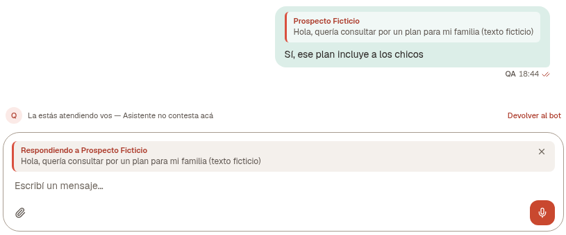
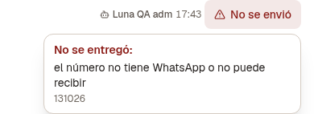
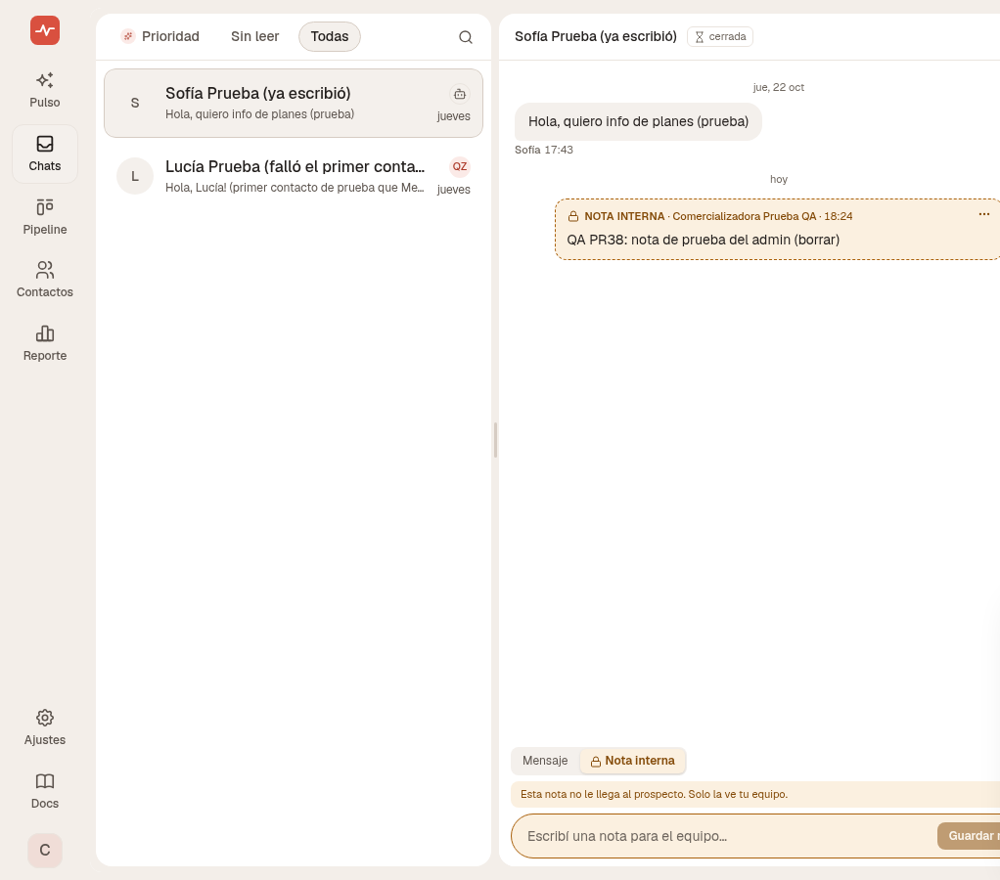
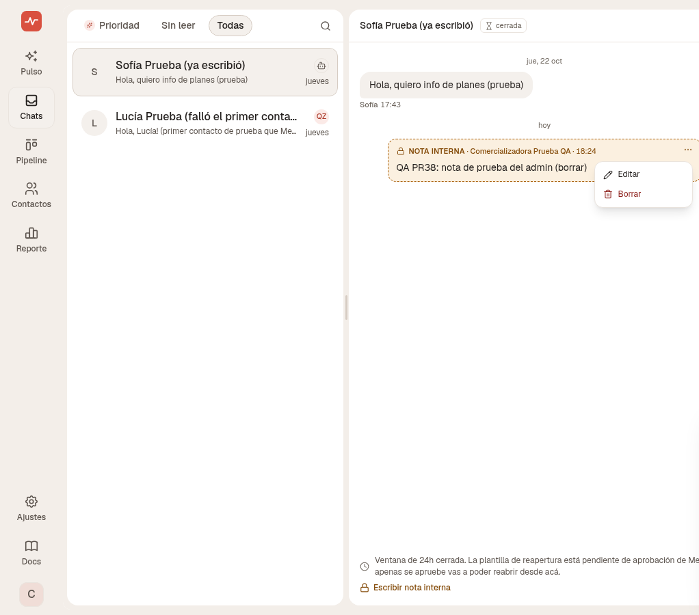

[Chats](/glosario#chats) son todas las conversaciones de [WhatsApp](/glosario#whatsapp) de la [empresa](/glosario#empresa). Las que atiende el [asistente](/glosario#asistente), las que atendés vos y las que esperan una persona.

{/* captura: lista de Chats con las pestañas Prioridad, Sin leer y Todas */}

## La lista

Arriba hay tres pestañas:

- **Prioridad.** El asistente se corrió y el [lead](/glosario#lead) espera una persona. Si hay alguien en esa cola, la pestaña se marca aunque estés en otra.
- **Sin leer.**
- **Todas.** La lista abre acá.

Si la [consulta](/glosario#consulta) está perdida o ganada, la conversación no entra en **Prioridad**. La seguís viendo en **Todas**, y en **Sin leer** si corresponde. Si el lead escribe después de ese cierre, vuelve a entrar.

La lupa busca por nombre o por el último mensaje. En el celular, arrastrar una fila la marca **Leída** o **No leída**. Si está en Prioridad, el otro lado dice **No necesita respuesta**.

Cada fila muestra quién escribió, qué dijo y quién está a cargo. El círculo puede ser el asistente o una persona del equipo. Tocándolo cambiás el responsable, si te corresponde.

Si Prioridad está vacía, vas a leer que nadie espera a una persona.

Si la cuenta está en [solo sus leads](/cuenta/visibilidad), el [asesor](/glosario#asesor) ve solo los chats de los leads de los que es dueño. Un chat del [asistente](/glosario#asistente), o de otro asesor, no le aparece. El [supervisor](/glosario#supervisor), la [gerencia](/glosario#gerencia) y el [administrador](/glosario#administrador) ven todos, también los que están [sin asignar](/glosario#sin-asignar).

Si la cuenta no está en ese modo, el asesor ve sus chats. El supervisor ve los de su equipo. El administrador y la gerencia ven todos.

## El hilo

Tocá una conversación para abrirla. En el celular, el menú de abajo se esconde: se sale con la flecha de volver.

Las burbujas se distinguen así: el lead de un lado, el asistente con contorno, y la persona del equipo con relleno. La firma del asistente es el nombre que le pusiste.

Si el asistente no contestó y dejó el motivo, en el hilo aparece un aviso centrado, como píldora, con el robot. Solo lo ve el equipo. No es una [nota interna](#notas-internas): esas las escribe una persona y van en amarillo. [Cuándo no responde](/automatico/asistente#cuando-no-responde).

Arriba está quién atiende. Si la estás atendiendo vos, el cartel dice que el asistente no contesta en este chat y el botón es **Devolver al bot**. Ese botón le devuelve la conversación al asistente.

Si todavía no la tomó nadie y hace falta una persona, primero la tomás. Recién ahí se habilita **Escribí un mensaje…**.

Podés adjuntar foto, video, audio o documento (hasta 25 MB) o grabar una nota de voz. Enter envía. Shift + Enter baja de línea.

{/* captura: un chat abierto, con el cartel «La estás atendiendo vos» y el botón Devolver al bot */}

## Responder citando un mensaje {#responder-citando-un-mensaje}

Podés citar un mensaje del [lead](/glosario#lead) y contestarle a ese mensaje. En WhatsApp le llega como respuesta a ese mensaje.

En la computadora, **Responder** queda siempre a la vista, al lado del mensaje del lead.

En el celular, mantené apretado el mensaje del lead. Ahí aparece **Responder**. Un toque no lo muestra.

1. Tocá **Responder**.
2. Arriba de la caja de texto queda **Respondiendo a** y el nombre. El mensaje citado se resume en un renglón. La **X** quita la cita. Si el mensaje es una foto, dice **Foto**. Si es un audio, dice **Audio**.
3. Escribí y enviá.

En el hilo, el mensaje que mandaste muestra la cita adentro de la burbuja. Tocá la cita: te lleva al mensaje original y lo resalta un momento.

<Frame caption="Ejemplo con datos ficticios.">
  
</Frame>

<Note>
**Responder** solo aparece en los mensajes del lead. No aparece en los del [asistente](/glosario#asistente) ni en los de una persona del equipo. Tampoco aparece si la [ventana de 24 horas](#la-ventana-de-24-horas) está cerrada, o si la conversación la está atendiendo otra persona.
</Note>

Si el envío falla, la cita se pierde. Volvé a tocar **Responder**.

## La ventana de 24 horas {#la-ventana-de-24-horas}

WhatsApp deja escribir libre mientras la persona escribió en las últimas 24 horas. El hilo avisa cuánto falta para que cierre.

Cuando cierra, el texto libre no sale. Solo sale una [plantilla](/glosario#plantilla) ya aprobada. El botón del pie pasa a **Reabrir conversación**. Igual podés dejar una [nota interna](#notas-internas).

## Mensajes que no se enviaron {#mensajes-que-no-se-enviaron}

Si un mensaje no salió, abajo aparece **No se envió** y el botón **Reintentar**.

Tocá **No se envió** para ver el motivo. Si el motivo es que falta el medio de pago en WhatsApp (Meta), también está el botón para cargarlo en Meta, y **Reintentar** al lado.

<Note>
Si el número del [lead](/glosario#lead) es incorrecto, inválido o no tiene WhatsApp, no hay **Reintentar**. Solo se ve el motivo.
</Note>

Al tocar **Reintentar** se muestra **Reenviando…**. Si sale, el mismo mensaje pasa a enviado, con la hora nueva. No se duplica. Si vuelve a fallar, muestra el motivo nuevo.

Si pasaron más de 24 horas desde el último mensaje del lead, la [ventana de 24 horas](#la-ventana-de-24-horas) está cerrada. **Reintentar** abre la elección de [plantilla](/glosario#plantilla) y muestra el mensaje que no salió, como referencia. En el celular, esa elección sube como una hoja desde abajo.

Después de reintentar con una plantilla, el mensaje original queda en **No se envió**. Ya no tiene **Reintentar**.

### Ver el motivo

Tocá **No se envió**. Se abre el recuadro **No se entregó:**. El motivo está en palabras simples. Si Meta mandó un código, va debajo, en chiquito. Según el caso suma un botón y, cuando se puede, **Reintentar**.

Los más comunes:

- «pasaron más de 24 h desde el último mensaje de la lead, hace falta una plantilla» (131047). **Reintentar** abre la elección de plantilla.
- «problema con el medio de pago de la cuenta de WhatsApp» (131042). El botón es **Agregar método de pago en Meta**.
- «el número no tiene WhatsApp o no puede recibir» (131026). No hay **Reintentar**.
- «Gestor perdió el permiso para enviar desde este número: hay que revisar la conexión de WhatsApp». El botón es **Revisar la conexión de WhatsApp**.
- «Meta limitó la cantidad de envíos por ahora: se reintenta más tarde».
- «el destinatario pidió no recibir más mensajes de marketing de la empresa». No le sigas mandando mensajes de marketing.
- «WhatsApp está temporalmente fuera de servicio: reintentar más tarde».
- Si falla la plantilla, el recuadro dice cuál es el problema y el botón es **Ver las plantillas**. Si falla un archivo, dice que no se pudo subir o que no se pudo descargar.

Si WhatsApp no manda código, el recuadro dice «WhatsApp no informó el motivo».

Si el código es uno que Gestor todavía no traduce, ves el texto que manda Meta, que puede venir en inglés, y el código. Si se repite, avisá a soporte con ese código.

<Frame caption="Ejemplo con datos ficticios.">
  
</Frame>

<Frame caption="Ejemplo con datos ficticios.">
  
</Frame>

## Notas internas {#notas-internas}

En el hilo podés dejar una nota para el equipo. Queda intercalada con los mensajes.

Es la misma nota del lead. Se ve también en **Notas** del panel al costado y, en el celular, en **Ficha del lead**. También está en la [ficha del contacto](/panel/contactos#la-ficha). Lo que escribís ahí aparece en el hilo como **Nota interna**, con la misma hora. Sin recargar puede tardar unos segundos.

<Note>
La nota no le llega al prospecto. No se manda por WhatsApp y el [asistente](/glosario#asistente) no la lee. Queda solo dentro de Gestor, para tu equipo.
</Note>

Arriba de la caja de texto elegís **Mensaje** o **Nota interna**.

1. Elegí **Nota interna**. La caja se pone amarilla. Queda fijo el aviso **Esta nota no le llega al prospecto. Solo la ve tu equipo.**
2. Escribí la nota.
3. Tocá **Guardar nota**.

En el hilo, la nota va centrada y en amarillo. Lleva el rótulo **Nota interna**, quién la escribió y la hora.

<Frame caption="Ejemplo con datos ficticios.">
  
</Frame>

Para volver a un mensaje normal, elegí **Mensaje** arriba de la caja.

En una nota tuya, los tres puntos (**…**) dan **Editar** y **Borrar**. Si la editás, queda marcada **· editada**. **Borrar** pide confirmación. En la nota de otra persona no aparecen los tres puntos: no la podés editar ni borrar.

Si la [ventana de 24 horas](#la-ventana-de-24-horas) está cerrada, el texto libre no sale, pero la nota sí. Debajo del aviso de ventana cerrada aparece **Escribir nota interna**. Eso abre la caja en modo nota. Pasa lo mismo si la conversación la está atendiendo otra persona.

<Frame caption="Ejemplo con datos ficticios.">
  
</Frame>

## La ficha al costado

En la computadora, el chat puede mostrar un panel al lado. Ahí está la [consulta](/glosario#consulta): grupo, zona, [etapa](/glosario#etapa). Si el lead llegó por un [anuncio](/glosario#anuncio), vas a ver **Llegó por este anuncio** y el link **Ver anuncio**.

**Notas** es la misma [nota interna](#notas-internas). El título dice **Notas · N**. Lo que escribís ahí aparece en el hilo. En el celular, ese panel se abre con el título **Ficha del lead**.

También está el seguimiento. Podés pausarlo. Si lo apagás del todo, no sale nada automático con esa persona hasta que vuelvas a prender el asistente. El botón de esa tarjeta es **Prender el bot**.

## Menú de la fila

Con el botón derecho, o dejando apretado en el celular, la fila ofrece:

- **Tomarla** o **Devolver al bot**.
- Marcar leída o no leída.
- Pausar el seguimiento, o activarlo ya, según cómo esté.

El seguimiento en sí —qué mensajes salen y cuándo— está en [El asistente](/automatico/asistente).
